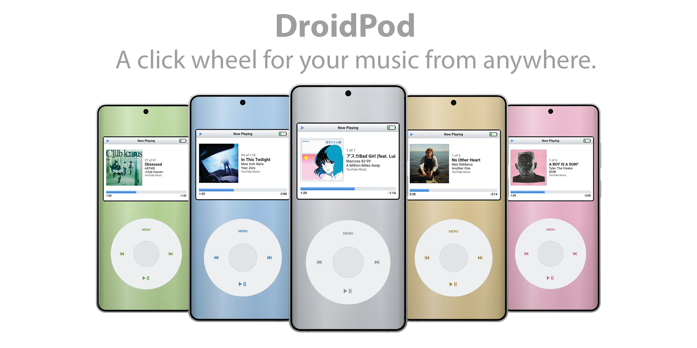

# DroidPod

A click wheel for whatever's playing on your Android phone.

DroidPod gives you a classic MP3-player screen and a touch click wheel that control the music already playing in **Spotify**, **YouTube Music**, or any other app that shows media controls on your lock screen. It has no account, no login, no API keys and no internet access. It only uses Android's built-in media controls.

## What it does

- **Now Playing:** title, artist, album, album art, elapsed and remaining time
- **Wheel controls:** spin to change volume; press the center to switch to scrubbing; tap ⏮ ⏭ ⏯ and MENU; hold ⏮/⏭ to rewind or fast-forward
- **Up Next:** the play queue, when the playing app shares it
- **Shuffle, repeat and app actions:** like Like or Thumbs Up, whatever the app exposes (hold the center button)
- **Players:** switch between apps that are playing, or resume or open Spotify, Apple Music, YouTube Music, Amazon Music, Tidal or Qobuz (whichever are installed). Use **Add Player** for any other app.
- **System styles:** *Classic* (color screen with album art) or *Retro*, a monochrome-LCD look in the Chicago Kare pixel font
- Case colors, click sound, haptics (Off/Light/Strong), wheel sensitivity, full screen, keep screen on and show on lock screen

What it doesn't do: browse your library, search, or open playlists. Those stay in the streaming app. Android doesn't give third-party apps a way to browse YouTube Music, so DroidPod sticks to what works with every player.

## Requirements

Android 11 or newer.

## Install

1. Download the latest `DroidPod-vX.Y.Z.apk` from [Releases](../../releases) and open it to install.
2. Open DroidPod and choose **Grant Access**, then turn DroidPod on. DroidPod needs Notification Access to see what's playing. It never reads your notifications.
3. **If the switch is greyed out** (Android 13+ does this for apps installed outside the Play Store):
   1. Go back to DroidPod and choose **Restricted Settings**. This opens DroidPod's App info page.
   2. Tap **⋮** in the top corner, then **Allow restricted settings** and confirm.
   3. Go back and choose **Grant Access** again.

To update, install the newer APK over the old one; your settings are kept.

## Using the wheel

| Control | Action |
|---|---|
| Spin | Move through menus; volume on Now Playing |
| Center | Select; on Now Playing, switch between volume and scrubbing |
| Hold center | Actions for the playing app (Like, shuffle, repeat, open app) |
| MENU | Back |
| Hold MENU | Back to the main menu |
| ⏯ | Play / pause (resumes the last player if nothing is playing) |
| ⏮ / ⏭ | Previous / next track |
| Hold ⏮ / ⏭ | Rewind / fast-forward |

The system back gesture works like MENU.

## What depends on the app

DroidPod can only use the controls each app offers. For example, Spotify Free doesn't allow going back a track or seeking, so those do nothing there. Up Next only appears when the app shares its queue (YouTube Music does; Spotify doesn't). Shuffle and Repeat use the app's own buttons when it has them.

## Help test players

Every app exposes slightly different controls. **Settings → Diagnostics** shows what each active player supports. Press the center button to copy the report, then paste it into an issue. The report leaves out song titles and artists.

## Building

Needs JDK 21 and the Android SDK (API 37).

```sh
./gradlew testDebugUnitTest assembleDebug
```

The debug APK is written to `app/build/outputs/apk/debug/`. It installs as a separate app, **DroidPod Debug**, so it can sit next to a release build (each needs its own Notification Access).

Signed releases are built by GitHub Actions when a `v*` tag is pushed. See [RELEASING.md](RELEASING.md) for creating the signing key and publishing.

## License

[GNU GPL v3](LICENSE).

The Retro style uses the [Chicago Kare](https://github.com/KingDuane/Chicago-Kare) typeface by Duane King, under the MIT License ([notice](app/src/main/assets/licenses/ChicagoKare-LICENSE.txt)).

DroidPod is not affiliated with Apple, Spotify or Google. All artwork is original.
